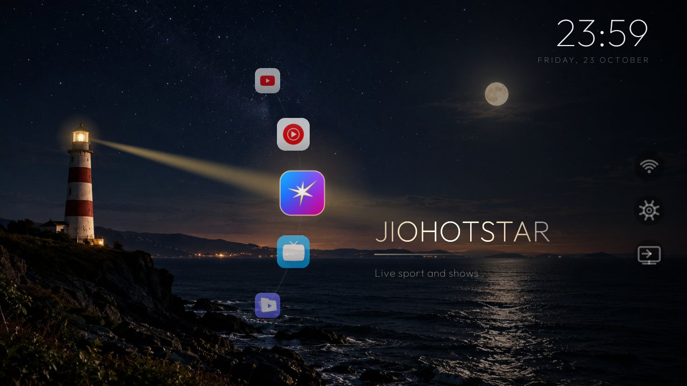
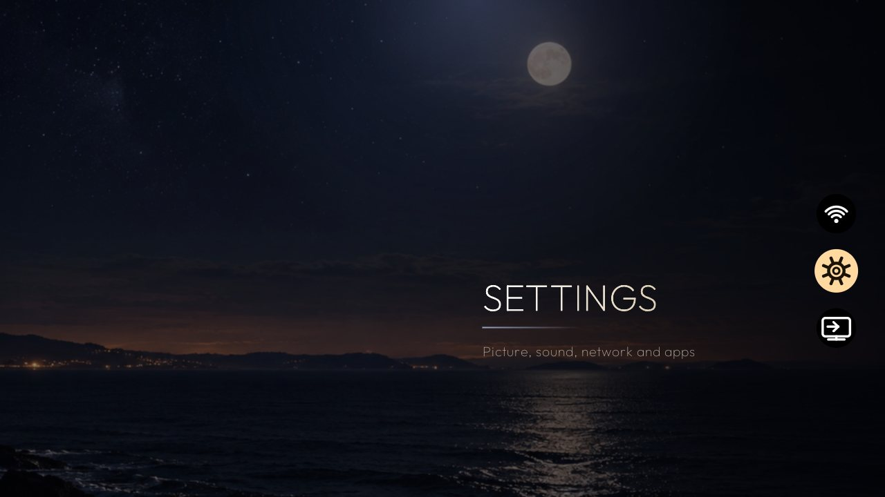

# LightHouse TV

**A replacement Home screen for Android TV.** Not a launcher with a different wallpaper — a
different way of moving through a TV.

A lighthouse on a night coast, an arc of your apps sliding past it like a wheel, and one beam of
light that always falls on the app in the centre. The name of the focused app is lit where the beam
crosses the type, and dark everywhere else.



- **No dependencies.** No AndroidX, no libraries, one APK of a few hundred KB.
- **No root, no system modifications.** It is a normal sideloaded app that asks to be Home.
- **Nothing is disabled or debloated.** Uninstalling leaves the TV exactly as it was.
- **Built for a 1 GB RAM Mi TV 4I** at 720p, and runs at 60 fps there — the renderer draws only what
  changes and idles at zero frames per second when you are not touching it.

**[Download the APK](https://github.com/vishnuvardhan0902/LightHouseTV/releases/latest)** ·
**[Install in one command](#one-command-if-you-already-use-adb)** ·
**[Ask your agent to do it](#let-your-agent-install-it)**

```bash
git clone https://github.com/vishnuvardhan0902/LightHouseTV.git
cd LightHouseTV
./tool/install.sh
```


---

## Install

### Let your agent install it

Paste this to Claude Code, Cursor, Codex, or any agent with shell access:

> Install LightHouse TV, the Android TV launcher in this repository, on my TV. Follow `AGENTS.md` exactly:
> find adb, connect to the TV over the network, run the install script, then verify that Home
> resolves to `tv.lighthouse.launcher/.MainActivity` and capture a screenshot so I can see it. My TV's IP is
> `____`.

`AGENTS.md` is written for a machine: exact commands, three objective acceptance checks, a failure
table, and the rollback.

### One command, if you already use adb

```bash
# macOS / Linux
chmod +x tool/*.sh
./tool/install.sh
```

```powershell
# Windows
powershell -NoProfile -ExecutionPolicy Bypass -File .\tool\install.ps1
```

It finds adb, uses the only connected device, installs `dist/lighthouse-tv-1.0.0.apk`, pre-grants the
optional location permission, and makes LightHouse TV Home. For a TV on the network, add the address —
`--serial 192.168.1.9:5555` / `-Serial 192.168.1.9:5555` — and the script connects first.

### By hand

1. Enable debugging on the TV: Settings → Device Preferences → About → tap **Build** seven times,
   then Developer options → **USB debugging** (or **Network debugging**).
2. Copy `dist/lighthouse-tv-1.0.0.apk` to a USB stick, plug it into the TV and open it with a file
   manager — or `adb install -r dist/lighthouse-tv-1.0.0.apk`.
3. Press HOME and choose **LightHouse TV → Always**. Or, over adb:

   ```bash
   adb shell cmd package set-home-activity tv.lighthouse.launcher/.MainActivity
   ```

---

## Controls

| Remote | What happens |
| --- | --- |
| **Up / Down** | One app per press, in both directions. The wheel is a circle: after the last app comes the first, in one step. |
| **OK** | Launches the centred app. |
| **Right** (or **MENU**) | Opens the side rail, on Settings. |
| **Up / Down** in the rail | Wi-Fi ↑, Settings ●, Inputs ↓ |
| **Left / BACK** | Back to the wheel. |
| **MUTE** | Turns the single wooden tick on and off. |

The rail is the only thing on the TV that changes the picture behind it: the camera pushes in and
slides right so the lighthouse leaves the frame, the wheel and the app name go, the picture darkens,
and the moon becomes the only light.



---

## How it works

Everything is one custom `View` drawing to a `Canvas`, with a `Choreographer` loop that only runs
when something is actually moving.

- **The wheel** is a single continuous `position` in app units driven by a critically damped spring,
  with fixed sub-steps so it behaves identically at 30 and 60 fps. The app index is derived, never
  stored, which is why a step across the end of the list is one step and not a lap.
- **The beam** is a sprite painted once into a 512×256 bitmap — a cone that is bright on its axis and
  fades sideways and toward the tip — then drawn as one rotated, scaled bitmap. Its angle is the
  direction from the lamp to the focused tile: a pure function of the wheel position, with no
  integrator of its own, so it cannot drift or oscillate when you are not pressing anything.
- **The name** is drawn twice: once flat at low alpha, then again through a radial gradient centred
  where the beam crosses the line of type, so the letters are white at the beam and fall into the
  dark either side.
- **The backdrop** is one photograph with a pre-composited overlay (vignette plus a right-hand
  scrim), so the whole scene is two `drawBitmap` calls.
- **The rail** cross-fades the entire scene through a single `navAlpha`, including a camera
  transform on the backdrop and a second moon glow.

The result is roughly 13 ms per frame on an Amlogic GPU, and zero frames drawn when idle.

---

## Which televisions this runs on

LightHouse TV is an Android TV app, so it runs on **anything running Android TV OS — Android 8.0
(API 26) or newer.** The install is a normal sideload: root is never needed and nothing on the TV is
modified beyond which app answers the Home button.

| Television | Runs it | Where debugging lives |
| --- | --- | --- |
| **Xiaomi Mi TV / Mi Box** | yes — the reference device | Settings → Device Preferences → About → tap *Build* 7× |
| **Google TV** (Chromecast, Sony, TCL, Hisense) | yes | Settings → System → About → tap *Android TV OS build* 7× |
| **Sony Bravia**, **Philips**, **Sharp**, **Grundig**, **Panasonic** (Android models) | yes | Settings → Device Preferences → About → tap *Build* 7× |
| **TCL**, **Hisense**, **Skyworth**, **Vodafone/Telekom** TV boxes | yes | varies slightly; same *About → Build* route |
| **Nvidia Shield** | yes | Settings → Device Preferences → About → tap *Build* 7× |
| **AOSP TV boxes** (Amlogic, Rockchip, onn.) | yes | usually Settings → About → tap *Build* 7× |
| **Amazon Fire TV** | no | Android underneath, but Home is locked by the firmware |
| **Roku, LG webOS, Samsung Tizen, Apple TV** | no | not Android |

### If your TV isn't Android

You can still have this — **any television becomes an Android TV by plugging one into its HDMI
port.** A Chromecast with Google TV, an onn. Google TV box, a Mi Box or a Shield turns the TV into a
screen; install LightHouse TV on the stick and the TV never sees its own menu again. That is the
universal answer for Samsung/LG/Roku owners: the TV is just the panel.

### Honest limitations on some firmwares

- **App icons on API 30+.** Package visibility changes on Android 11 can hide other apps' icons; on
  those builds the wheel may show only the focused tile's icon. Nothing else is affected.
- **Pinned stock launcher.** A few vendors re-resolve Home at boot. LightHouse TV still appears in
  the Home chooser; pick it once with *Always*.
- **Overscan on older panels.** If the edges are clipped, set the TV's picture size to *Just Scan* /
  *Screen Fit* / *16:9 overscan off*.

---

## Build from source

Requires **JDK 17** and the **Android SDK platform 34**.

```bash
./tool/build.sh          # macOS / Linux
.\tool\build.ps1         # Windows
```

or straight Gradle: `./gradlew assembleRelease -x lintVitalRelease`. The APK lands in `dist/`.

The release APK is signed with a local debug key by default — enough to sideload and to upgrade over
itself. Set `LIGHTHOUSE_KEYSTORE` (plus `LIGHTHOUSE_STORE_PASSWORD`, `LIGHTHOUSE_KEY_ALIAS`,
`LIGHTHOUSE_KEY_PASSWORD`) to sign with your own.

To publish a release, push a tag: `.github/workflows/android.yml` builds on every push and attaches
the APK to a GitHub Release for `v*` tags.

---

## Uninstall

```bash
./tool/restore.sh                    # hand Home back to the launcher the TV shipped with
./tool/restore.sh --uninstall        # ...and remove LightHouse TV
```

On Windows, `.\tool\restore.ps1 [-Uninstall]`. By hand, the equivalent is
`adb uninstall tv.lighthouse.launcher` — the TV falls back to its own launcher.

---

## If something goes wrong

| Symptom | Fix |
| --- | --- |
| Home does not change | On the TV press HOME, choose LightHouse TV, choose *Always*. Or check the candidates: `adb shell cmd package query-activities -a android.intent.action.MAIN -c android.intent.category.HOME` |
| Wi-Fi shows "Connected" without a name | Android 9+ hides SSIDs: `adb shell pm grant tv.lighthouse.launcher android.permission.ACCESS_FINE_LOCATION` |
| `INSTALL_FAILED_UPDATE_INCOMPATIBLE` | `adb uninstall tv.lighthouse.launcher` then install again |
| Black screen | `adb logcat -d -b crash` for the stack, `adb shell am force-stop tv.lighthouse.launcher` to clear |

---

## Repository layout

```
app/src/main/java/tv/lighthouse/launcher/
  MainActivity.java     Choreographer loop, Home intent, permission request
  LightHouseView.java   the renderer: backdrop, beam, wheel, info panel, rail
  AppRepository.java    installed apps, filtered and stably sorted
  SoundEngine.java      the single tick
tool/
  install.*  restore.*  build.*    the scripts, in bash and PowerShell
AGENTS.md            machine instructions for installing and verifying
docs/screenshots/    the images in this README
dist/                the prebuilt APK
```

---

## Licence and credits

MIT — see [LICENSE](LICENSE).

- Type: **Outfit** by Smartsheet, SIL Open Font License.
- Background photograph: supplied by the project author. If you redistribute this repository, make
  sure you have the right to ship that image, or replace
  `app/src/main/res/drawable-nodpi/bg_night.jpg` with your own — any 16:9 night scene works, and the
  banner (`banner.jpg`) is cropped from it.
